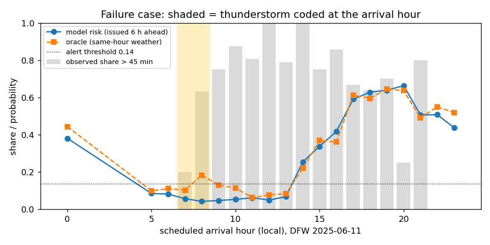

# Failure case: DFW arrivals on 2025-06-11 (h = 6 h)

Auto-selected as the test day with the largest gap between observed and predicted severe-delay share (h = 6, hub arrivals, >= 80 sampled flights).

## Hourly timeline

|   local_hour |   flights |   actual_gt45 |   model_risk_h6 |   flagged |   oracle_risk |   ts_seen_at_issue |   ts_at_arrival_hour |   prcp_at_arrival_mm |   wind_at_arrival_kt |
|-------------:|----------:|--------------:|----------------:|----------:|--------------:|-------------------:|---------------------:|---------------------:|---------------------:|
|            0 |         1 |         0     |           0.381 |     1     |         0.443 |                  0 |                    0 |                  0   |                6.048 |
|            5 |         5 |         0     |           0.085 |     0     |         0.099 |                  0 |                    0 |                  0   |                0     |
|            6 |         7 |         0     |           0.082 |     0     |         0.111 |                  0 |                    0 |                  0   |                4.104 |
|            7 |        20 |         0.2   |           0.057 |     0     |         0.103 |                  0 |                    1 |                  0   |                0     |
|            8 |        19 |         0.632 |           0.042 |     0     |         0.183 |                  0 |                    1 |                  1.5 |                2.916 |
|            9 |        20 |         0.75  |           0.047 |     0     |         0.13  |                  0 |                    0 |                  3   |                7.019 |
|           10 |         8 |         0.875 |           0.053 |     0     |         0.114 |                  0 |                    0 |                  1.5 |                5.076 |
|           11 |        26 |         0.808 |           0.062 |     0.038 |         0.063 |                  0 |                    0 |                  0   |                7.991 |
|           12 |         1 |         1     |           0.049 |     0     |         0.078 |                  0 |                    0 |                nan   |                5.076 |
|           13 |        19 |         0.789 |           0.068 |     0     |         0.083 |                  0 |                    0 |                  0   |                4.104 |
|           14 |         7 |         1     |           0.254 |     1     |         0.22  |                  1 |                    0 |                  0   |                5.076 |
|           15 |        16 |         0.75  |           0.338 |     1     |         0.369 |                  1 |                    0 |                  0   |                8.963 |
|           16 |         7 |         0.857 |           0.417 |     1     |         0.361 |                  1 |                    0 |                  0   |               12.041 |
|           17 |        12 |         0.667 |           0.591 |     1     |         0.612 |                  1 |                    0 |                  0   |               13.013 |
|           18 |        11 |         0.636 |           0.628 |     1     |         0.596 |                  0 |                    0 |                  0   |               12.041 |
|           19 |        10 |         0.7   |           0.639 |     1     |         0.646 |                  0 |                    0 |                  0   |                7.991 |
|           20 |         4 |         0.25  |           0.663 |     1     |         0.636 |                  0 |                    0 |                  0   |               11.069 |
|           21 |        10 |         0.8   |           0.506 |     1     |         0.491 |                  0 |                    0 |                  0   |                8.963 |
|           22 |         1 |         0     |           0.507 |     1     |         0.549 |                  0 |                    0 |                  0   |                9.935 |
|           23 |         6 |         0     |           0.438 |     1     |         0.519 |                  0 |                    0 |                  0   |                7.991 |

## Five worst-missed days

|                                           |   n |   actual |   pred |   oracle |   miss |
|:------------------------------------------|----:|---------:|-------:|---------:|-------:|
| ('DFW', Timestamp('2025-06-11 00:00:00')) | 210 |    0.624 |  0.233 |    0.264 |  0.391 |
| ('DFW', Timestamp('2025-01-05 00:00:00')) | 209 |    0.66  |  0.281 |    0.38  |  0.38  |
| ('DFW', Timestamp('2025-03-04 00:00:00')) | 124 |    0.653 |  0.286 |    0.38  |  0.368 |
| ('DFW', Timestamp('2025-07-07 00:00:00')) | 283 |    0.435 |  0.148 |    0.171 |  0.287 |
| ('DFW', Timestamp('2025-05-02 00:00:00')) | 205 |    0.468 |  0.207 |    0.296 |  0.262 |

## What happened

DFW, Wednesday 11 June 2025. Meteostat codes a **thunderstorm at DFW 07:00–08:00 local** (coco 25),
followed by rain until ~13:00. Overnight (01:00–04:00) there was light rain but no thunder, and
pressure was flat (1014–1015 hPa), so no pressure-tendency or convective signal existed earlier.

- Arrivals scheduled **07:00–10:00**: 63–88% were > 45 min late. The 6-hour model said **4–6%**,
  well below the 0.14 alert threshold. **Every horizon (3, 6, 9, 12 h) missed these hours**: the
  issue times (01:00–07:00) all fall before the first thunder observation.
- Arrivals **11:00–13:00**: still missed at h = 6 (issued 05:00–07:00), but the **3-hour forecast
  caught them** (risk 0.18 → 0.39, above threshold), because by 08:00 the storm and the first
  departure delays at DFW were in its inputs.
- From **14:00** even the 6-hour forecast flags every hour (0.25 → 0.66), driven by the hub's own
  state (mean departure delay 60–97 min, 3-hour severe share 0.78–0.90), not by weather.

## Why the model missed it

1. **Pop-up convection is not in the past observations.** The model only sees weather up to the
   issue time. A storm that forms within the forecast window is invisible; this is the leakage
   rule working as intended, not a bug.
2. **Even same-hour weather doesn't explain it.** The oracle (weather at the arrival hour) only
   reached 0.18 at 08:00. The damage comes from the backlog a 1–2 h storm creates at a hub
   (holding, ground stop, misplaced aircraft and crews), which lasts 6+ hours after the rain stops.
   Hourly station weather (one point, 1-hour resolution, gusts and visibility missing) can't
   describe that.
3. The fix is a **forecast input** (TAF thunder probability, convective outlook/CCFP), not more
   past observations. We did not have those archives within the hackathon time.

## How a user would notice

- **Refresh at short horizons.** The 3-hour board flipped to high risk at 08:00, about 3 hours
  before the worst arrivals and 6 hours before the 6-hour board caught up. The dashboard should
  show the newest, shortest-horizon forecast first and mark a jump in it.
- **Watch the drivers.** The top drivers switch from calendar/carrier terms to `hub_dep_delay_mean`
  and `hub_sev_rate_3h`. A board full of "hub state" drivers is a sign the airport is already in
  trouble and earlier long-horizon forecasts are stale.
- **Low probability is not "safe".** On a summer morning with moisture around, the model's 5%
  means "no signal yet", not "no storm". The coordinator still checks the TAF and the convective
  outlook; the model does not replace them.
